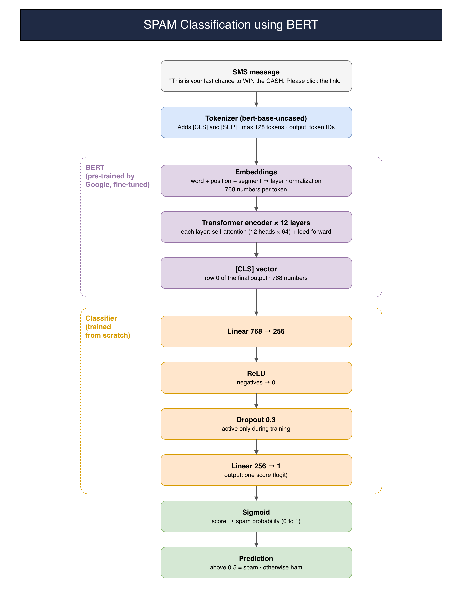

<h1 align="center">Hugging Face: SPAM Classification using BERT</h1>

<p align="center"><i>BERT is an encoder-only Transformer: every word can look at all the other words, before and after it.</i></p>

<p align="center">
  
  
  
  
  
</p>

---

## 1. Project Overview

Spam messages are more than an annoyance: they waste time, and many try to trick people into clicking harmful links or giving away money. A good spam filter has to catch as much spam as possible, without ever blocking a real message.

In this project, I fine-tuned Google's pre-trained **BERT** model to classify SMS messages as **spam** or **ham** (not spam). Beyond building the classifier, I looked inside the model step by step to understand how BERT turns a message into a spam probability: from tokens and embeddings, through attention and 12 layers, to the final score.

**Objectives:**
- Fine-tune BERT for spam classification on the SMS Spam Collection dataset.
- Evaluate the model with metrics suited to imbalanced data (precision, recall and F1, not only accuracy).
- Understand and visualize what happens inside the model for a single message.

---

## 2. Interactive Walkthrough

👉 **[Inside a Spam-Detecting BERT](https://vamshi-thatipamula.github.io/huggingface-spam-classification-using-bert/)**

An interactive, step-by-step page that follows one SMS message through the trained model, using its real numbers:

- **Tokens:** how the message is split into tokens and IDs
- **Embeddings:** how each token becomes 768 numbers
- **Attention:** where each token looks, across all 12 layers and 12 heads
- **12 layers:** how much each token changes on its way through BERT
- **Classifier:** how the [CLS] vector becomes one score
- **Probability:** how the score becomes the spam probability
- **Results:** the model's performance on the test set

---

## 3. Credits

- **Dataset:** SMS Spam Collection by Tiago A. Almeida and José María Gómez Hidalgo
  - Original source: [UCI Machine Learning Repository](https://archive.ics.uci.edu/dataset/228/sms+spam+collection)
  - License: [CC BY 4.0](https://creativecommons.org/licenses/by/4.0/)
- **Model:** BERT (bert-base-uncased) by Google
  - Original source: [Hugging Face Model Hub](https://huggingface.co/google-bert/bert-base-uncased)
  - License: [Apache 2.0](https://www.apache.org/licenses/LICENSE-2.0)
- **Project idea:** The course **Deep Learning**, conducted by **Codebasics**
- **Interactive walkthrough:** My own addition, built with the help of [Claude](https://claude.ai) by Anthropic

Many thanks to the dataset's creators, to Google for BERT, to Mr. Dhaval Patel and the Codebasics team for the project idea, and to Anthropic for Claude, which helped build the interactive walkthrough.

> **Note:** The dataset is not included in this repository. The notebook downloads it automatically from Hugging Face (`ucirvine/sms_spam`). This project is created strictly for educational and portfolio demonstration purposes.

---

## 4. Project Architecture

<p align="center">
  
</p>

The model has two main parts:

- **BERT (pre-trained by Google, fine-tuned):** turns the message into tokens and embeddings, passes them through 12 Transformer layers, and summarizes the whole message in the [CLS] vector (768 numbers).
- **Classifier (trained from scratch):** reduces the [CLS] vector from 768 numbers to 256, then to one score. A sigmoid turns the score into the spam probability, and anything above 0.5 counts as spam.

---

## 5. Project Workflow

1. **Load the data:** load the SMS Spam Collection from Hugging Face.
2. **Explore and clean:** check how many messages are spam and ham and how long the messages are, and remove 403 duplicate messages (5,171 left, 12.63% spam).
3. **Split the data:** 70% training, 15% validation and 15% test, keeping the same spam share in each part.
4. **Tokenize:** convert each message into token IDs with the `bert-base-uncased` tokenizer (maximum 128 tokens).
5. **Build the model:** BERT with a small classifier on top (768 → 256 → 1).
6. **Train:** fine-tune the whole model for 3 epochs and keep the version with the lowest validation loss.
7. **Evaluate:** measure accuracy, precision, recall and F1 on the test set, and check the confusion matrix.
8. **Test on new messages:** predict the spam probability for example messages.
9. **Look inside the model:** follow one message step by step through tokens, embeddings, attention, the 12 layers and the classifier.
10. **Export for the walkthrough:** save the model's internal numbers for the example message to build the interactive page.

---

## 6. Key Decisions

- **Removed 403 duplicate messages:** otherwise the same message could appear in both training and test data, making the results look better than they really are.
- **Stratified split:** each part (training, validation and test) has the same share of spam as the full dataset (about 12.63%), so the test set is a fair sample of the whole dataset.
- **Maximum length of 128 tokens:** covers almost every message. Only 7 messages were longer, all of them ham.
- **Two learning rates:** a small one for BERT (2e-5), so its language knowledge is only gently adjusted, and a larger one for the new classifier (1e-3), which learns from scratch. This is better
- **One output with a sigmoid:** a single score turned into a spam probability, with 0.5 as the threshold between spam and ham.
- **Kept the epoch with the lowest validation loss:** epoch 1. In later epochs, the training loss kept falling while the validation loss rose, an early sign of overfitting.
- **Focused on precision for spam:** wrongly blocking a real message is the more costly mistake for a spam filter.
- **Fixed random seeds (42):** so the results can be repeated.

---

## 7. Results

**Test set:** 776 messages the model never saw during training.

- **Accuracy:** 99.36% (771 of 776 messages classified correctly)
- **Spam precision:** 100% (no real message was wrongly flagged as spam)
- **Spam recall:** 94.9% (93 of 98 spam messages were caught)
- **Spam F1 score:** 0.974

**Confusion matrix:**

|                 | Predicted ham | Predicted spam |
|-----------------|---------------|----------------|
| **Actual ham**  | 678           | 0              |
| **Actual spam** | 5             | 93             |

**Example predictions** (new messages, not from the dataset):

- "This is your last chance to WIN the CASH. Please click the link." → **83.5% spam** (spam)
- "Dear Vamshi, I hope to see you on Sunday." → **0.1% spam** (ham)
- "I won the office quiz competition yesterday, the prize was a free dinner haha" → **1.5% spam** (ham)

The third message contains typical spam words ("won", "prize", "free"), yet the model correctly recognized it as a normal message from its context.

---

## 8. Project Structure

```
huggingface-spam-classification-using-bert/
├── architecture/
│   ├── spam_classification_using_BERT.drawio   # Editable diagram (draw.io)
│   └── spam_classification_using_BERT.png      # Architecture diagram
├── docs/                                       # Interactive walkthrough (GitHub Pages)
│   ├── data.json
│   └── index.html
├── notebook/
│   └── spam_classification_using_BERT.ipynb    # Main notebook
├── .gitignore
├── README.md
└── requirements.txt                            # Required libraries
```

---

## 9. Tech Stack

- **Language:** Python
- **Deep learning:** PyTorch
- **NLP model and tokenizer:** Hugging Face Transformers (BERT)
- **Data loading:** Hugging Face Datasets
- **Data handling:** pandas, NumPy
- **Evaluation:** scikit-learn
- **Visualization:** Matplotlib
- **Development:** Jupyter Notebook in PyCharm
- **Diagram:** draw.io
- **Interactive walkthrough:** HTML, CSS and JavaScript, hosted on GitHub Pages

---

## 10. How to Run

1. **Clone the repository:**
   ```bash
   git clone https://github.com/vamshi-thatipamula/huggingface-spam-classification-using-bert.git
   cd huggingface-spam-classification-using-bert
   ```

2. **Install the required libraries:**
   ```bash
   pip install -r requirements.txt
   ```

3. **Open and run the notebook:**
   Open `notebook/spam_classification_using_BERT.ipynb` in Jupyter or PyCharm and run the cells in order.

> The dataset and the BERT model are downloaded automatically. Training creates the model file `best_spam_bert.pt` (about 440 MB) in the `notebook` folder; it is not included in this repository because of its size. Section 14 of the notebook exports `bert_walkthrough_data.json`, the data behind the interactive walkthrough (a copy is saved as `docs/data.json`). The notebook runs on a GPU (CUDA), Apple Silicon (MPS) or CPU.

---

## 11. Conclusion

Fine-tuning Google's pre-trained BERT on the SMS Spam Collection produced a highly accurate spam classifier: 99.36% accuracy on unseen test messages, with no real message wrongly flagged as spam. The model also handled messages with spam-like words correctly, showing that it understands context rather than just keywords.

Beyond the results, this project gave me a clear, step-by-step understanding of how BERT works inside, from tokens and embeddings, through attention and 12 layers, to the final spam probability. The interactive walkthrough brings these steps together in one place.
